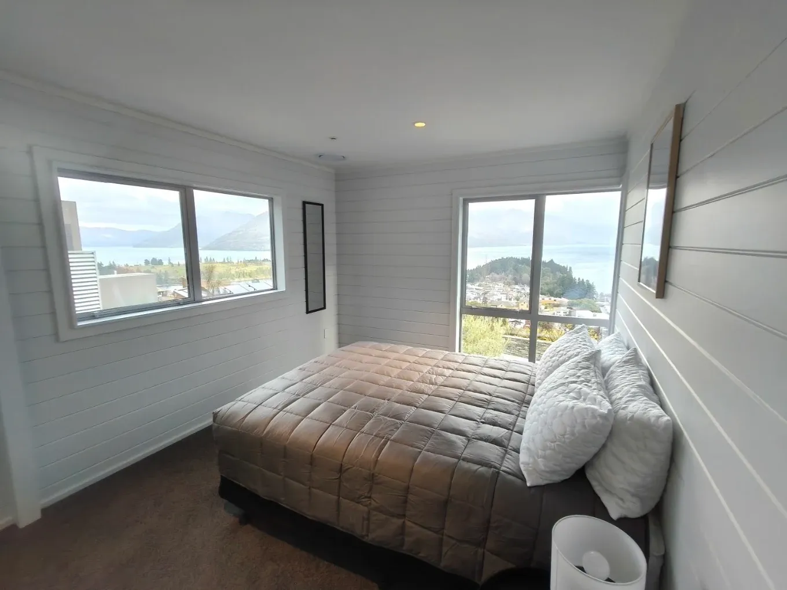

# Repaint Queenstown — website admin

An admin login at `/admin.html` that lets you change **any text and any image**
on the site without touching code. Edits save to Supabase and appear on the live
site immediately — there is no rebuild and no deploy.

---

## One-time setup (about 5 minutes)

### 1. Create the database table and image bucket

Supabase dashboard → project **`bffddgypusotsdwpaliy`** → **SQL Editor** →
**New query** → paste the whole of [`supabase/schema.sql`](supabase/schema.sql)
→ **Run**.

This creates:

| What | Where | Who can read | Who can write |
|---|---|---|---|
| `repaint_site_content` table | Database | anyone (it is public website copy) | listed Repaint editors only |
| `repaint-site-images` bucket | Storage | anyone | listed Repaint editors only |
| `repaint_site_editors` table | Database | nobody from the browser | SQL editor only |

Everything is prefixed `repaint_` / `repaint-` (tables, the
`repaint_is_site_editor()` function, the trigger, every policy) so it cannot
collide with the Everest Painters CMS or the CRM in the same project. The
script is safe to run more than once.

Row level security is on throughout, so the publishable key in the browser can
only ever read.

Do this **before or straight after** the CMS code is deployed. Until the table
exists, every page view asks Supabase for content, gets a 404 back and shows the
HTML as it is. Nothing breaks, but the browser console shows the 404.

### 2. The publishable key

Already done. `assets/cms-config.js` holds the project URL and the
**publishable** key (starts `sb_publishable_...`) for `bffddgypusotsdwpaliy`,
the same one the Everest site uses:

```js
url: 'https://bffddgypusotsdwpaliy.supabase.co',
anonKey: 'sb_publishable_...',
bucket: 'repaint-site-images'
```

This key is meant to be public — it is what the RLS policies above are for.
**Never put the `service_role` key in this file.**

### 3. Create the admin login

Supabase dashboard → **Authentication → Users → Add user → Create new user**:

- Email: whoever should be able to edit the site (Sam, for example)
- Password: set one
- Tick **Auto Confirm User** — without it the login fails silently

Users are shared across the whole project. If the person already has a login
(as an Everest editor or a CRM user), skip this step and just grant them Repaint
rights below; the same email and password then work on both sites.

### 4. Grant that user editing rights

Creating the account is not enough on its own; a Supabase user with no entry in
`repaint_site_editors` can read the site but cannot save anything. In the **SQL
Editor**, with their email:

```sql
insert into public.repaint_site_editors (user_id)
select id from auth.users where email = 'you@example.com'
on conflict (user_id) do nothing;
```

Repeat per person. To revoke access without deleting the account:

```sql
delete from public.repaint_site_editors
where user_id = (select id from auth.users where email = 'you@example.com');
```

Rights are per site: a row here does not let anyone edit Everest, and an
`everest_site_editors` row does not let anyone edit Repaint.

Then commit and push — Vercel redeploys automatically.

---

## Using it

1. Go to **`/admin.html`** and sign in.
2. You land on the homepage in edit mode. Every editable thing gets a dashed
   blue outline.
3. **Click any text** → a panel opens on the right with a box to type in. The
   page updates as you type.
4. **Click any image** → drop a new photo in, or click to choose one. Add alt
   text (the description used by screen readers and Google).
5. **Save** publishes to the live site straight away.
6. **Reset to original** puts back what the page shipped with. In the SEO
   panel it resets both the title and the description.

The toolbar switches between `index`, `terms` and `privacy`. The **SEO**
button edits the browser tab title and the Google search description, and the
**Intro** button edits the opening splash that shows for a second while each
page loads (the logo on the homepage, the name on the legal pages). Each page
has its own splash, title and description, so change all three pages if you
rebrand.

A few things on the homepage work slightly differently:

- **Phone numbers and email buttons** show a second **Link** box under the
  text. Phone links look like `tel:+64226947311`. The email buttons open a
  Gmail draft; the address sits after `to=` in that link (the `@` is written
  `%40`), and you can swap the whole link for `mailto:you@example.com`.
- **The rotating review under the hero buttons**: clicking it opens the whole
  list. One review per line, written as `quote | name`. The rotation pauses
  while you are editing.
- **The scrolling strip of words** under the hero: click it to edit the list,
  one word or phrase per line.
- **Hero photos**: the slideshow pauses in edit mode. Use the dots to bring a
  photo forward, then click it. On a wide screen the dots move left, clear of
  the open panel; on a phone the panel covers the photo, so press **Close**
  first.
- **Service photos**: hover a service in the list to bring its photo forward,
  then click the photo.
- The caption under the service photo copies the service heading, so it changes
  when you edit the heading.

Unsaved changes are kept while you move around the page, but not across a
reload — the browser warns you before you lose them.

---

## How it works

Every editable element in the HTML carries a stable key:

```html
<h3 data-cms="index.services.h3_2" data-cms-type="text">Interior repaints</h3>

```

Keys read `<page>.<section>.<tag>_<n>`. The sections on the homepage are
`meta`, `intro`, `header`, `mobile-menu`, `hero`, `marquee`, `services`,
`about`, `why`, `work` (the gallery), `crew`, `reviews`, `review-banner`,
`contact`, `map` and `footer`; on the legal pages `meta`, `intro`, `header`,
`mobile-menu`, `page-head`, `content` and `footer`.

`assets/cms.js` reads `repaint_site_content` and applies any row whose key
matches. The HTML in the repo is always the fallback: if Supabase is
unreachable, if the key is missing, or if a row is deleted, the page shows
exactly what it shows today. Nothing can white-screen the site.

Content types:

| `data-cms-type` | Meaning |
|---|---|
| `text` | Replaces the element's inner HTML. A few blocks contain `<em>`, `<b>` or `<a>` on purpose — the panel warns you when that is the case. |
| `textnodes` | Buttons with an icon. Only the words change, the icon is left alone. |
| `image` | Swaps `src` and `alt`. |
| `attr:content` | The `<meta name="description">` tag. |
| `attr:data-reviews`, `attr:data-words` | The rotating hero reviews and the scrolling word strip. `script.js` builds those from the attribute. |

`data-cms-href="1"` marks the phone, email and Gmail links whose address is
editable as well as their words.

After every change it applies, `assets/cms.js` fires a `cms:applied` event.
`script.js` listens for it and re-syncs what it builds itself: the service
photo caption, the rotating reviews, the word strip, the Gmail links and the
footer year. While the editor is open (`<html class="cms-on">`) the hero
slideshow and the review rotation hold still.

### Re-running the annotator

If the HTML is edited by hand later and new sections are added, re-run:

```bash
python3 tools/annotate.py index.html terms.html privacy.html
```

It only ever inserts `data-cms` attributes and skips elements that already have
one, so existing keys — and therefore existing saved content — stay valid. A
new element in a section that already has keys gets the next free number (a
new gallery photo becomes `index.work.img_30`, say, wherever it sits), so it
never shares a key with an existing one. If you add an element by copying one
that is already keyed, delete `data-cms` and `data-cms-type` from the copy
first; the annotator warns about any key that appears twice. It also leaves
alone the lightbox, the service caption and the word strip, which `script.js`
fills in. The `index.hero.reviews` and `index.marquee.words` keys
were added by hand; if you change the default reviews or words in the HTML,
change them in the `data-reviews` / `data-words` attribute.

### Things worth knowing

- **Search engines see the HTML defaults, not the edited copy.** That was the
  accepted trade-off for instant publishing. If a change matters for SEO (page
  title, description, headings), fold it back into the HTML at some point.
- **Replaced images are served from Supabase Storage**, not from `/img`.
  Resize photos to roughly 1600px wide and under ~1MB before uploading.
- **Hero photos are shown whole, never cropped.** Use landscape photos at about
  3:2 so they fill the frame; a squarer photo gets plain margins either side.
  The services and gallery photos are cropped to fit, so any shape works there.
- **Uploads are never deleted automatically.** Old files stay in the bucket; tidy
  them up in the Supabase dashboard if it gets cluttered.
- **Not editable here:** the map, where the Google review links point (their
  wording is editable), and the social preview (`og:` tags).
- `/admin.html` is `noindex` and disallowed in `robots.txt`.
